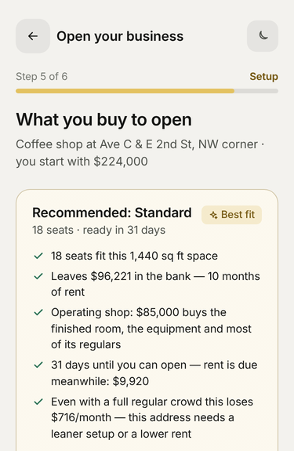
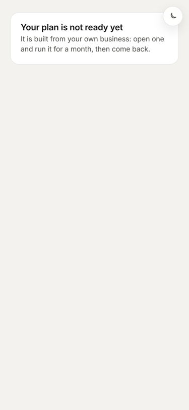
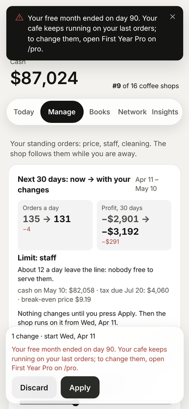
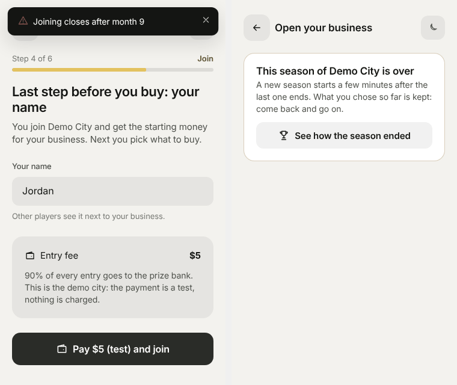
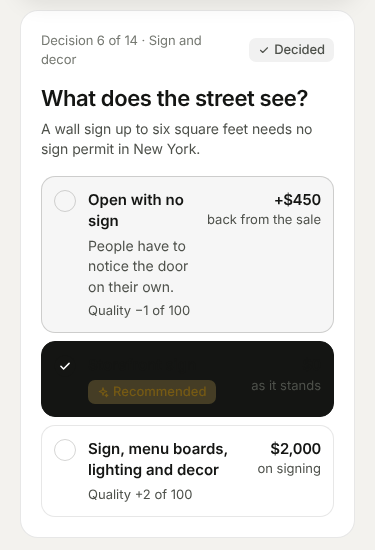

# BUGS — поломки по прогону в браузере (B06)

Сверху самые тяжёлые. У каждой: где видно, снимок, файл, кому чинить. Прогон одной командой:

```bash
node scripts/e2e/journey.mjs
```

Против ветки сборщика (B04) в отдельной рабочей копии: `scripts/e2e/cycle.sh`. Против выложенной игры: `node scripts/e2e/journey.mjs --url https://<адрес>`.

**Последний прогон:** 14 ноября, круг 4, 23:46–23:58 UTC, сборка сборщика B04 `59646fd` (с калибровкой экономики B11): **48 шагов из 48 на 375 и 1440** — гость → идея → место → план → вход → 14 карточек решений → разрешения → открытие → шесть вкладок → прогноз и «Apply» → «Your change» на следующий день → совет → правка при идущих часах → сделка → жалоба → стол инспектора → `/brief` → месяц → отказ после бесплатного месяца → `/pro` → «Get Pro» → конец сезона → личный план. После калибровки: третий месяц +$1 039 (375) и +$1 389 (1440), итог сезона #9 из 16. Живой показ по RUNBOOK — `PITCH-CHECK.md` (обе ветки 12 из 12). Прежние круги: 23:30 `c49c646` — 48 из 48; 23:16 `4b76a07` — 46 из 48; 22:52 `777a20b` — 44 из 44; 22:45 основа `ac5a14d` — 38 из 38.

Номер у поломки постоянный (на него ссылаются журналы); порядок на странице — по тяжести. Как читать «кому»: номер задания из `build/ROUND3.md`; «ведущий» — файл, который по правилам меняет только ведущий; «третий ведущий» — вид и `client/src/ui/`, `client/src/screens/home/`.

---

## 16. На телефоне «Next» под карточкой решения уезжает вниз: `position: sticky` не работает во всём приложении

**Тяжесть: высокая (карточки решений — главный «решение → последствие» в открытии; 14 карточек).** Сборка B04 `c49c646`, проба 23:36 UTC.

На карточках решений B07 нижняя панель «Next: …» и верхняя строка «cash left / doors open / bills a month» задуманы липкими (`position: sticky` в `decisions.css`). На телефоне они не липнут: кнопка «Next» стоит ниже края экрана на каждой карточке — 375×812: 845–1320 px при высоте 812; 375×667 и 390×844 — так же. Игрок прокручивает к «Next» на каждом из 14 решений, а верхняя строка с деньгами уезжает вверх как раз тогда, когда он смотрит варианты внизу.

Причина: `client/src/ui/tokens.css`, `.app { overflow-x: hidden; }` (строка ~129). `overflow-x: hidden` делает `.app` отдельной прокручиваемой областью, и всё `sticky` внутри перестаёт липнуть к экрану. **Проверено:** с `.app { overflow-x: clip; }` (обрезает так же, но не создаёт прокручиваемой области) «Next» стоит на экране на всех трёх карточках: 737–791 px из 812. Затрагивает и другие липкие элементы приложения (строка состояния сверху, `.split__aside`).

Проверка — шаг `setup` прогона `node scripts/e2e/journey.mjs --widths 375` пишет «"Next" is BELOW THE FOLD» или «"Next" on screen»; на снимке `docs/qa/screens/phone-05-decision.png` кнопки «Next» на экране нет.

**Кому:** третий ведущий (`client/src/ui/tokens.css`: `overflow-x: hidden` → `overflow-x: clip` у `.app`; у `body` можно оставить). После правки — проверить, что на 375 не появилась горизонтальная прокрутка (шаги прогона это меряют).

## 1. Игра советует набор, который по её же расчёту убыточен — и ставит его первым

**Тяжесть: высокая (жюри откроет кафе по рекомендации и будет терять деньги каждый месяц).**

- Шаг Place: помещения отсортированы «от самого дешёвого открытия», игрок берёт первое по карману.
- Шаг Setup: карточка «Recommended: Standard · Best fit» и в ней же: «Even with a full regular crowd this loses $475/month — this address needs a leaner setup or a lower rent». Кнопка одна — «Open with recommended setup».
- После открытия: прогноз месяца на Manage −$4 600…−$5 600; Insights — «You need 5,028 orders a month to break even. You are on track for 3,120».
- Итог сезона у игрока, который принял рекомендацию и поднял цену на $0,50: #14–#15 из 16 кофеен, $55 000 из $224 000. Лучшая кофейня ИИ закончила с $218 000 — тоже в минусе от старта.



**На сборке B04 `59646fd` (с калибровкой B11, 23:46 UTC) третий месяц уже в плюсе: +$1 039 (375) и +$1 389 (1440), итог сезона #9 из 16.** На `c49c646` (23:30 UTC): с рекомендованными решениями B07 прогноз первого месяца −$1 313 вместо −$5 132; третий месяц −$988 (375) и +$772 (1440); итог сезона #12 и #10 из 16. Первое место списка — по-прежнему тихое («Quiet · 0 rivals»), обзор перед подписью честно говорит «146 orders a day pay the bills · an average shop here sells 139».

**Кому:** B11 (калибровка `extra.footfall`: новичок с рекомендованным набором на двери по карману должен выживать в 4 случаях из 5), B07 (`client/src/screens/start/`: не помечать «Best fit» набор, который по своему расчёту в минусе; на шаге Place показывать, в плюсе ли место, а не только цену открытия). Сортировка мест — `cheapestOpening` в `client/src/screens/start/kit.ts` (B07).

## 13. Конец сезона: бесплатному игроку личный план говорит «not ready yet» — неправда и тупик

**Тяжесть: высокая (последний экран игры и то, за что платят).** Сборка B04 `c72ad4d` (с тарифом B14), 23:14 UTC.

Игрок без Pro отыграл сезон (кофейня работала с 36-го по 360-й день), на экране итога нажимает «Open my plan» и видит: «Your plan is not ready yet. It is built from your own business: open one and run it for a month, then come back.» Кнопок нет. На деле `real_world_plan` после бесплатного месяца отвечает 402 (план — только Pro, решение B14), а экран плана показывает общий текст про «не открыл бизнес».



**Кому:** B09 (`client/src/screens/end/PlanScreen.tsx`): на 402 показать заголовки плана из `teaser` статуса тарифа и кнопку на `/pro` (B14 просил о том же в своём журнале, просьба 4). Проверка: шаг `plan-final` прогона.

## 17. Ветка показа «больше мест»: лист «Resize the room» не показывает последствия до нажатия

**Тяжесть: средняя-высокая (это одна из двух веток, которые выбирает жюри на сцене; правило волны — «решение и сразу последствие»).** Сборка B04 `c49c646`, 23:45 UTC, `node scripts/e2e/pitch-show.mjs --branch seats`.

Manage → «Resize» → лист «Resize the room»: шаговик мест, «Cafe chair × 6 $294», «Two-top table × 6 $210», правило «18 sq ft per seat». Прогноза месяца с новым числом мест нет, хотя движок его считает (`what_if` с полем `size`, `shared/src/types.ts`). Для цены прогноз есть («Next 30 days: now → with your changes»), для мест — нет. Подробности и снимок — `PITCH-CHECK.md`.

**Кому:** B08 (`client/src/screens/business/ManageTab.tsx`, лист «Resize the room»).

## 14. Момент оплаты без кнопки: «open First Year Pro on /pro» — текстом

**Тяжесть: средняя (20% оценки — «что продаём»; это единственное место, где игрок решает платить).** Сборка B04 `4b76a07`, 23:20 UTC.

После бесплатного месяца (день 90) игрок меняет цену на Manage и жмёт «Apply». Наверху тост и в панели внизу: «Your free month ended on day 90. Your cafe keeps running on your last orders; to change them, open First Year Pro on /pro.» Путь `/pro` написан текстом, кнопки или ссылки нет. На сборке `c49c646` (23:40 UTC) вкладка «Pro» уже помещается в ряд на 375, но рядом с отказом кнопки по-прежнему нет. Сам `/pro` работает: «Get Pro» в тестовом режиме открывает Pro, и то же изменение проходит (цена 8,25 → 8,45).



**Кому:** B08 (`client/src/screens/business/`): на ошибке с `/pro` (`isPaywallError` из `client/src/screens/paywall`) — кнопка «See Pro» рядом с «Apply» (B14 просил о том же, просьба 2); B14 — текст отказа без пути `/pro`.

## 12. Игра предлагает набор, который сама же не даёт открыть

**Тяжесть: средняя (игрок выбирает предложенный вариант и получает отказ).**

Проба по всем 116 помещениям (`recommend_opening` для кофейни, сверка с правилом `seatRuleBroken`, 23:10 UTC): из 312 предложенных наборов 6 — «premium» на 24 места без `customer_restroom`, все 6 по карману (остаток $11 000–$15 700). `open_business` их отклоняет: «20 or more seats need: Customer restroom upgrade (NYC Health Code §81.22). Add it or keep under 20 seats». Помещения: `ev-005`, `ev-016`, `ev-053`, `ev-058`, `ev-062` и ещё одно.

Причина: `engine/src/economy/actions.ts`, `seatRuleBroken` (правило из `pack.extra.seatThresholds`) проверяется при открытии, а подбор наборов в `engine/src/analytics/` о нём не знает.

**Кому:** ведущий (`engine/src/analytics/`: добавлять `customer_restroom` в набор от 20 мест или резать до 19); B07 — в своём выборе мест (`decisions/model.ts`) проверить то же правило, чтобы «Sign the lease» не упиралась в отказ.

## 15. Каждый созданный демо-город живёт вечно и с ботами — проверки против выложенной игры будут копить нагрузку

**Тяжесть: средняя-высокая (для публичного адреса во время судейства).** Сборка B04 `c49c646`, чтение кода 23:33 UTC. **С исправлением №18 (`c38dfe8`) важнее:** теперь каждый гость, пришедший в общий город поздно в сезоне, создаёт новый город, а города не закрываются — на репетиции против сервера с `NODE_ENV=production` после трёх проверок осталось два города, которые сами идут по дню в 2 секунды.

`server/src/index.ts`: `recycleDemos` перезапускает **любой** демо-город (`demo`, `demo-2`, `demo-3`…), у которого кончился сезон, через 10 минут — новым, с идущими часами и жителями-ботами; `boot` при каждом старте сервера поднимает все `demo-N` из снимков. Создать город можно только запросом `POST /api/worlds` (в интерфейсе такой кнопки нет) — это делают проверки: мой прогон, `scripts/prod-check.mjs --new-city` (B05), CI. Каждая проверка против публичного адреса оставляет город, который потом идёт сам по дню в 2 секунды; после 20 таких городов `POST /api/worlds` отвечает «Too many demo cities».

**Кому:** ведущий / A5 (`server/src/index.ts`): перезапускать по концу сезона только `demo` (и город показа по команде), а `demo-N` после конца сезона закрывать и не поднимать из снимков. B05 — не запускать `prod-check --new-city` против публичного адреса много раз. Мой прогон против `--url` теперь не доводит сезон до конца (только с `--end`) и оставляет свой город на паузе: он занимает место из 20, но не грузит сервер.

## 3. «Feb 30» и «Jan 30» в датах

**Тяжесть: средняя (жюри видит несуществующую дату на экране денег).**

Books: «Wages, rent and monthly bills are paid on Feb 30», «closed Jan 30», «Cash on Jan 30». Manage, прогноз: «cash on Feb 30». В игре 30-дневные месяцы, а подпись — настоящий месяц: `dateOf` в `shared/src/rules.ts` строит `label` как `${MONTHS[month-1]} ${dayOfMonth}` с днём до 30.


**Кому:** ведущий (`shared/src/rules.ts`). Варианты: последний день месяца подписывать «end of Feb»; или подписи брать по настоящему календарю (день года × 365/360).

## 5. На телефоне первый экран — карта, поле идеи ниже сгиба

**Тяжесть: средняя для «затянуть с первой минуты».**

375×812: весь первый экран — карта с наложенными друг на друга подписями («#2 Victor's coffee s…» поверх «#1 Daniel's…», «ber…» поверх «Omar's…»), «Offline map», «Season 0», «0 Owners». Заголовок «Test your business idea in real New York.» начинается внизу, поле идеи и «See my plan» — только после прокрутки. На 1440 всё на первом экране.


**Кому:** третий ведущий (`client/src/screens/home/`), подписи карты — B10 (`client/src/map/`).

## 9. Список мест на телефоне: адрес в 4–5 строк, первым стоит тихое место

На 375 у строки помещения «opens from $127,779» занимает половину ширины, адрес и подпись переносятся по слову: «Ave B / between E / 12th St & E / 13th St, / west side, / mid-block». Три места занимают весь экран. И первое по списку (самое дешёвое) — «Quiet · 0 rivals»: тихая улица, на которой рекомендованный набор по расчёту игры теряет деньги (№1).


На сборке B04 частично исправлено (B07): цена коротко — «$128k», адрес занимает 2–3 строки. Первым по-прежнему стоит тихое место.

**Кому:** B07 (`client/src/screens/start/steps.tsx`, `PlaceStep`: цену — под адресом, а не колонкой справа), вид строки — третий ведущий (`ListRow`).

## 6. Суммы в карточках «What to change» обрезаны справа на 375

«+$3,819/mo» → «+$3,819/m», «+$639/mo» → «+$639/m» (снимок в №2).

**Кому:** B08 (`TodayTab.tsx`), вид — третий ведущий.

## 8. Экран бизнеса нарисован своей копией набора компонентов

`client/src/screens/business/*.tsx` импортируют `Card`, `Button`, `Stepper` из `client/src/screens/business/__stubs__/ui.tsx` («Minimal copies of the shell's UI kit … Swap these imports for client/src/ui when it lands»), а не из `client/src/ui`. Отличаются разметка и подписи (`More price` вместо `Increase price`). Жюри читает репозиторий: слово `__stubs__` в главном экране продукта.

**Кому:** третий ведущий / B08.

## 10. Мелкое

- План открытия: у 2 из 25 шагов нет ссылки на официальную страницу (шаги 1–2 «Write a one-page plan», «Decide the format»). **Кому:** B09.
- Личный план содержит общий текст «$22,000 in prime Manhattan» вместо чисел игрока. **Кому:** B09.
- Ждём разрешения, 375: названия обрезаны («Build-out: what it take…», «Food Service Establis…»). **Кому:** B07 (`WaitStep.tsx`).
- Books: «Taxes +$278» зелёным в «This month so far» — это собранный налог с продаж, его надо отдать; зелёный плюс читается как доход. **Кому:** B08 (`BooksTab.tsx`).
- Manage: 97 включённых элементов на одном экране, из них 24 переключателя «Cut corners». Решение цены и штата тонет. **Кому:** B08.
- Today: подписи оси графика «Last 30 days» другим шрифтом, чем весь экран. **Кому:** B08 / третий ведущий.
- Главная, 1440: легенда карты закрывает подпись «© OpenStreetMap contributors» («reetMap contributors»). **Кому:** B10.
- Network, 375 (сборка B04): строка «Every neighbor sees your deal record.» начинается от самого края экрана, без отступа 16 px, как у остальных строк. **Кому:** B18 (`client/src/screens/network/`).
- Today (сборка B04): «Month report on Feb 30 (in 21 days)» — та же дата, что в №3.
- Insights, 1440 (сборка B04): ключевые числа и график безубыточности — на первом экране, советник — ниже сгиба (условие B09 «всё главное без прокрутки на 1440» выполнено не целиком). В первый месяц после открытия «Where your money goes» показывает месяц стройки: «Jan, last full month · Rent $9,600 · 100%» — будто аренда — единственный расход. **Кому:** B09 (`client/src/screens/insights/`).

## Исправлено

Номера, которые больше не воспроизводятся в последней сборке; оставлены, чтобы было видно, что проверено.

### 18. Судья на публичном адресе примерно в 6 случаях из 10 не может войти в демо-город — и узнаёт это только на последнем шаге — исправлено в сборке B04 `c38dfe8` (гость, который открыл общий демо-город поздно в сезоне или после конца, сам попадает в новый город), проверено 00:08 UTC: `demo` на 11-м месяце → гость в `demo-2`, вошёл и дошёл до карточек решений; `demo` окончен → гость в `demo-3`, вошёл. Следствие — №15 стал важнее

**Тяжесть: критическая для показа на публичном адресе (40% оценки — «works end-to-end in production»).** Сборка B04 `59646fd`, проба 23:52 UTC.

Публичный адрес открывает общий демо-город `demo` (`detectWorld()` → `'demo'`). Его сезон — 12 месяцев по 30 дней по 2 секунды: **12 минут**. Вход закрыт после 9-го месяца (`RULES.JOIN_UNTIL_MONTH: 9`, `shared/src/rules.ts`; проверка — `host/src/index.ts:146`), то есть после 9-й минуты. После конца сезона город 10 минут стоит законченным (`DEMO_RESTART_MIN`, по умолчанию 10), потом начинается новый. Цикл 22 минуты, из них **13 минут войти нельзя**.

Что видит гость:
- **месяцы 10–12:** главная и шаги идея → место → план → имя проходят как обычно; на «Pay $5 (test) and join» — тост «Joining closes after month 9», и всё. Ни на главной, ни на плане ни слова о том, что вход закрыт; что делать дальше — не сказано;
- **сезон окончен:** «This season of Demo City is over. A new season starts a few minutes after the last one ends… come back and go on» — 10 минут ожидания.



**Кому:** ведущий / третий ведущий / B07 — решение за ведущим; варианты, от простого:
1. На шаге Start, если в `demo` вход закрыт (месяц > `JOIN_UNTIL_MONTH` или `phase !== 'running'`), — кнопка «Start a fresh city» → `POST /api/worlds` → переход в `?world=demo-N`. Сервер это уже умеет; клиент — нет. Вместе с №15 (чтобы такие города не жили вечно).
2. Для публичного адреса — перезапускать `demo` сразу (`DEMO_RESTART_MIN` близко к нулю; сейчас `0` значит «никогда») и не закрывать вход в демо-городе.
3. Как минимум — на главной и на шаге плана писать, сколько минут осталось до закрытия входа.

### 11. На телефоне первый экран появляется через 13 секунд: сервер отдаёт файлы без сжатия — исправлено в сборке B04 `6e540bc` (сжатие br/gzip и долгий кэш для /assets/), замер 00:00 UTC: телефон на Slow 4G — 897 КБ по сети, поле идеи через 5,0 с вместо 14,2 с; компьютер — 0,58 с. Осталось: карта (maplibre) в главном файле — вынести отдельным куском дало бы ещё секунды на телефоне

**Тяжесть: высокая (первая минута и «works in production»).**

`node scripts/e2e/perf.mjs` — главная, профиль телефона как у Lighthouse (Slow 4G: 1,6 Мбит/с, 150 мс, процессор ×4): **2 683 КБ по сети, поле идеи готово через 12,9 с**. На компьютере: 3 937 КБ, поле готово через 0,55 с. **На сборке B04 `4b76a07` (23:27 UTC) хуже: 2 931 КБ, 14,2 с; JS вырос до 2 289 КБ, сжатия по-прежнему нет.**

Что тяжёлое (всё «not compressed»):
- `assets/index-*.js` — 2 072 КБ одним файлом (в нём и maplibre); сжатый gzip был бы 603 КБ (вывод `vite build`);
- `assets/offline-map-*.png` — 1 269 КБ (на компьютере);
- `/api/packs` — 222 КБ при каждом входе;
- `assets/index-*.css` — 169 КБ.

Причина: `server/src/index.ts` отдаёт `client/dist` через `express.static` без сжатия; в `Dockerfile`, `railway.json` и в черновике `docs/DEPLOY.md` (B05) сжатия тоже нет. Сжимает ли Railway сам — проверю `perf.mjs --url` после выкладки (там видно `content-encoding`).

**Кому:** ведущий (`server/src/index.ts`: сжатие ответов — пакет `compression` или заранее сжатые файлы сборки); B10 / третий ведущий — загружать карту (maplibre) отдельным куском после первого экрана: на телефоне поле идеи не должно ждать карту.

### 2. Совет «Too many empty seats» предлагает изменение, которое по его же числу теряет деньги — исправлено в сборке B04 `9198651` (сборщик: `if (d <= 0) return null` и тест), проверено прогоном 23:55 UTC: на Today нет советов с минусом

**Тяжесть: высокая (кнопка Apply ведёт в минус; «Apply all» применяет и его).**

Today → «What to change» → «Too many empty seats −$902/mo — Shrink to 10». Число справа — это прогноз прибыли после изменения (`impact.profitDeltaMonth`), и он отрицательный.

Причина в коде: `engine/src/analytics/recommend.ts`, правило `manySeats` (строка ~136) и вторая ветка `fewSeats` (~119) не проверяют знак `d`, а остальные правила проверяют (`if (d <= 0) return null;` в строках 174, 186, 358). Починка — одна строка `if (d <= 0) return null;` перед `return rec('many_seats', …)`.


**Кому:** ведущий (`engine/src/analytics/` — в задании B09 только `realWorldPlan` и `roadmapFor`); показ — B08.

### 4. После «Save settings» Today не показывает обещанное — исправлено в сборке B04 `c72ad4d`

В сборке с B08: на следующий игровой день Today показывает «Your change applied Feb 9 · Price $8.50 → $9.00 · 1 day on the new settings: 96 a day. Forecast was 92 (+4). On track ✓». Ниже — как было на `ac5a14d`.

**Тяжесть: средняя (готовность B08: «на следующий игровой день видит обещанное в Today»).**

Manage: +$0,50 к цене → прогноз меняется до сохранения (−$5 132 → −$5 634) — это работает. «Save settings» → баннер «Saved. From … your business runs on the new settings.» Через игровой день Today не упоминает ни новую цену, ни её действие (в `TodayTab.tsx` цены нет вовсе).

**Кому:** B08 (`client/src/screens/business/TodayTab.tsx`).

### 7. План открытия: «Longest wait 240 days» пугает сроком, которого не будет — исправлено в сборке B04 (B07)

В сборке с B07 шапка плана — «31 days from the lease to open doors», аренда за ожидание посчитана. Ниже — как было на `ac5a14d`.

Шаг Plan, шапка: «Steps 25 · Fees $4,529 · Longest wait 240 days». 240 дней — шаг 18 «Optional: apply for sidewalk seating». Новичок читает, что до открытия 8 месяцев, а игра открывает его через 31 день.


**Кому:** B07 (`client/src/screens/start/steps.tsx`, `PlanStep`): необязательные шаги не считать в «Longest wait» или подписать «(optional)».

## Ветки до слияния

Прогон `scripts/e2e/cycle.sh origin/claude/<ветка> --no-end --widths 375` — та же проверка на ветке исполнителя, пока она не у сборщика.

### B07 `focused-goodall-tjv1ym` @ `c8df08f` — 23:08 UTC, путь проходит до конца

- **Решение → последствие работает.** 14 карточек решений; первое собственное решение («Which espresso machine?» → Three-group) сразу двигает верхнюю строку: «cash left $96,221 → $92,121» и метка «−$4,100». Обзор перед подписью честно показывает ставку: «Orders a day that pay those bills 146 · An average, known shop on this corner sells 139 a day».
- **Исправлено у B07:** №7 (вместо «Longest wait 240 days» — «31 days from the lease to open doors», аренда за ожидание посчитана: «31 days × $320 = $9,920»); №9 частично (цена в списке мест — «$128k» коротко, адрес занимает 2–3 строки вместо 5). Прогноз месяца после открытия с рекомендованными решениями B07 — −$1 313 против −$5 132 на основе (меньше штата).
- **Новое, B07:** на карточке «What does the street see?» выбранный вариант «as it stands» отрисован чёрным блоком, его название не видно (видны только значок «Recommended» и «as it stands»). Снимок — после перехода к карточке по точке навигации; на карточке «Which espresso machine?» выбранный вариант выглядит нормально. Причину не установил. `client/src/screens/start/decisions/`.

  

- **Новое, B07:** экран ожидания в «Ahead» показывает «Optional: apply for sidewalk seating», хотя игрок в решениях выбрал «No sidewalk tables».
- **Ещё не исправлено в ветке B07:** №1 (первое место списка — «Quiet · 0 rivals», ставка проигрывает: 146 нужно против 139 возможных), №5, №11.
- Для сборщика: после слияния B07 мой прогон не сломается — шаги «место», «план» и «набор» понимают и старый, и новый вид (проверено на обеих сборках).

## Что проверено и работает

- Идея по-английски распознаётся как кофейня; имя подставляется.
- 21–22 из 86–87 свободных помещений по карману; кнопка «Open here» выключена на дорогих.
- Вход после плана; сессия сохраняется; набор покупается; аренда идёт с подписания; разрешения выдаются за 31 игровой день; «Open doors» открывает.
- «While you were away» показывается после пропущенных дней и закрывается.
- Пять вкладок открываются, у каждой есть содержимое; на 375 нет горизонтальной прокрутки.
- Прогноз месяца меняется до сохранения; сохранение доходит до движка; баннер «Saved. From Fri, Feb 10 your business runs on the new settings.»
- «Apply» у совета на Today доходит до движка, карточка говорит «Applied ✓ from tomorrow».
- Черновик цены на Manage не сбрасывается, пока город идёт (6 игровых дней на демо-скорости), панель «Save settings» остаётся.
- Инспектор в своём браузере на `/desk` видит дело по жалобе в очереди и берёт его.
- Тёмная тема (кнопка-луна; системную тему игра сама не подхватывает и остаётся светлой — это не ломает экраны): главная, карточки решений, обзор перед подписью, Today, Network, Insights читаются, контраст в порядке (`--scheme dark`, сборка B04, 23:29 UTC).
- Сделка (cross-promo) из листа соседа доходит до движка, сосед принимает — сделка активна.
- Жалоба из «Report to the city» доходит до очереди инспектора.
- Через 32 дня в истории появляется месяц; к дню 360 сезон заканчивается; экран итога, «Open my plan», личный план с 33 внешними ссылками и кнопкой печати.
