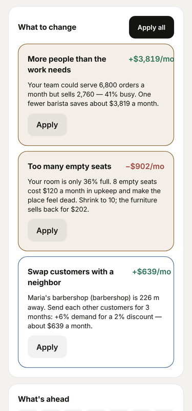
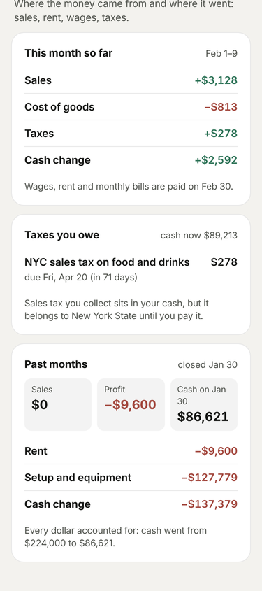
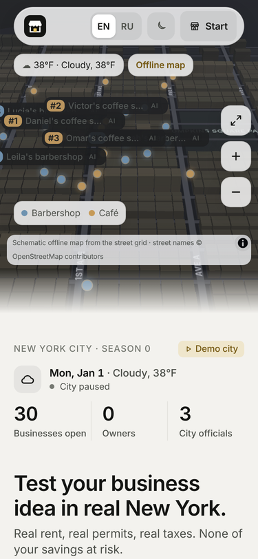
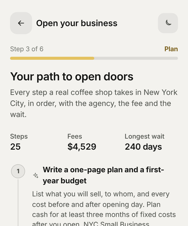
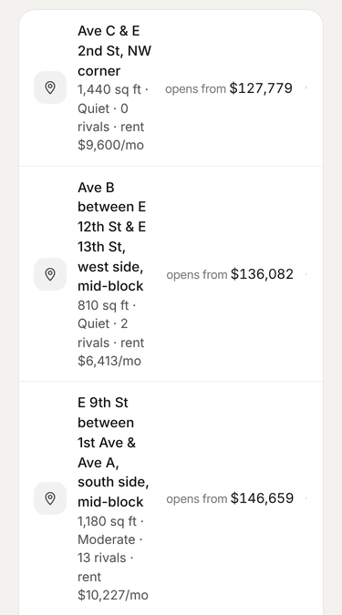

# BUGS — поломки по прогону в браузере (B06)

Сверху самые тяжёлые. У каждой: где видно, снимок, файл, кому чинить. Прогон одной командой:

```bash
node scripts/e2e/journey.mjs
```

Против ветки сборщика (B04) в отдельной рабочей копии: `scripts/e2e/cycle.sh`. Против выложенной игры: `node scripts/e2e/journey.mjs --url https://<адрес>`.

**Последний прогон:** 14 ноября, 22:52 UTC, сборка сборщика B04 `777a20b` — 44 шага из 44 (новые: совет на Today, правка при идущих часах, стол инспектора); до этого 22:45 UTC, основа `ac5a14d` — 38 из 38. Ширина 375 и 1440. Путь гость → идея → место → план → вход → набор → разрешения → открытие → пять вкладок → прогноз цены и сохранение → сделка → жалоба → месяц → конец сезона → личный план: **38 шагов из 38 проходят через интерфейс, без падений страницы, без ответов 5xx, без горизонтальной прокрутки ни на 375, ни на 1440.** Единственная ошибка в консоли — на главной и шаге идеи не загружается внешний ресурс (`net::ERR_TUNNEL_CONNECTION_FAILED`): песочница не выпускает его наружу, карта показывается как «Offline map». На публичном адресе проверю отдельно. Ниже — то, что работает, но мешает игроку или жюри.

Номер у поломки постоянный (на него ссылаются журналы); порядок на странице — по тяжести. Как читать «кому»: номер задания из `build/ROUND3.md`; «ведущий» — файл, который по правилам меняет только ведущий; «третий ведущий» — вид и `client/src/ui/`, `client/src/screens/home/`.

---

## 1. Игра советует набор, который по её же расчёту убыточен — и ставит его первым

**Тяжесть: высокая (жюри откроет кафе по рекомендации и будет терять деньги каждый месяц).**

- Шаг Place: помещения отсортированы «от самого дешёвого открытия», игрок берёт первое по карману.
- Шаг Setup: карточка «Recommended: Standard · Best fit» и в ней же: «Even with a full regular crowd this loses $475/month — this address needs a leaner setup or a lower rent». Кнопка одна — «Open with recommended setup».
- После открытия: прогноз месяца на Manage −$4 600…−$5 600; Insights — «You need 5,028 orders a month to break even. You are on track for 3,120».
- Итог сезона у игрока, который принял рекомендацию и поднял цену на $0,50: #14–#15 из 16 кофеен, $55 000 из $224 000. Лучшая кофейня ИИ закончила с $218 000 — тоже в минусе от старта.


**Кому:** B11 (калибровка `extra.footfall`: новичок с рекомендованным набором на двери по карману должен выживать в 4 случаях из 5), B07 (`client/src/screens/start/`: не помечать «Best fit» набор, который по своему расчёту в минусе; на шаге Place показывать, в плюсе ли место, а не только цену открытия). Сортировка мест — `cheapestOpening` в `client/src/screens/start/kit.ts` (B07).

## 11. На телефоне первый экран появляется через 13 секунд: сервер отдаёт файлы без сжатия

**Тяжесть: высокая (первая минута и «works in production»).**

`node scripts/e2e/perf.mjs` — главная, профиль телефона как у Lighthouse (Slow 4G: 1,6 Мбит/с, 150 мс, процессор ×4): **2 683 КБ по сети, поле идеи готово через 12,9 с**. На компьютере: 3 937 КБ, поле готово через 0,55 с.

Что тяжёлое (всё «not compressed»):
- `assets/index-*.js` — 2 072 КБ одним файлом (в нём и maplibre); сжатый gzip был бы 603 КБ (вывод `vite build`);
- `assets/offline-map-*.png` — 1 269 КБ (на компьютере);
- `/api/packs` — 222 КБ при каждом входе;
- `assets/index-*.css` — 169 КБ.

Причина: `server/src/index.ts` отдаёт `client/dist` через `express.static` без сжатия; в `Dockerfile`, `railway.json` и в черновике `docs/DEPLOY.md` (B05) сжатия тоже нет. Сжимает ли Railway сам — проверю `perf.mjs --url` после выкладки (там видно `content-encoding`).

**Кому:** ведущий (`server/src/index.ts`: сжатие ответов — пакет `compression` или заранее сжатые файлы сборки); B10 / третий ведущий — загружать карту (maplibre) отдельным куском после первого экрана: на телефоне поле идеи не должно ждать карту.

## 2. Совет «Too many empty seats» предлагает изменение, которое по его же числу теряет деньги

**Тяжесть: высокая (кнопка Apply ведёт в минус; «Apply all» применяет и его).**

Today → «What to change» → «Too many empty seats −$902/mo — Shrink to 10». Число справа — это прогноз прибыли после изменения (`impact.profitDeltaMonth`), и он отрицательный.

Причина в коде: `engine/src/analytics/recommend.ts`, правило `manySeats` (строка ~136) и вторая ветка `fewSeats` (~119) не проверяют знак `d`, а остальные правила проверяют (`if (d <= 0) return null;` в строках 174, 186, 358). Починка — одна строка `if (d <= 0) return null;` перед `return rec('many_seats', …)`.



**Кому:** ведущий (`engine/src/analytics/` — в задании B09 только `realWorldPlan` и `roadmapFor`); показ — B08.

## 12. Игра предлагает набор, который сама же не даёт открыть

**Тяжесть: средняя (игрок выбирает предложенный вариант и получает отказ).**

Проба по всем 116 помещениям (`recommend_opening` для кофейни, сверка с правилом `seatRuleBroken`, 23:10 UTC): из 312 предложенных наборов 6 — «premium» на 24 места без `customer_restroom`, все 6 по карману (остаток $11 000–$15 700). `open_business` их отклоняет: «20 or more seats need: Customer restroom upgrade (NYC Health Code §81.22). Add it or keep under 20 seats». Помещения: `ev-005`, `ev-016`, `ev-053`, `ev-058`, `ev-062` и ещё одно.

Причина: `engine/src/economy/actions.ts`, `seatRuleBroken` (правило из `pack.extra.seatThresholds`) проверяется при открытии, а подбор наборов в `engine/src/analytics/` о нём не знает.

**Кому:** ведущий (`engine/src/analytics/`: добавлять `customer_restroom` в набор от 20 мест или резать до 19); B07 — в своём выборе мест (`decisions/model.ts`) проверить то же правило, чтобы «Sign the lease» не упиралась в отказ.

## 3. «Feb 30» и «Jan 30» в датах

**Тяжесть: средняя (жюри видит несуществующую дату на экране денег).**

Books: «Wages, rent and monthly bills are paid on Feb 30», «closed Jan 30», «Cash on Jan 30». Manage, прогноз: «cash on Feb 30». В игре 30-дневные месяцы, а подпись — настоящий месяц: `dateOf` в `shared/src/rules.ts` строит `label` как `${MONTHS[month-1]} ${dayOfMonth}` с днём до 30.



**Кому:** ведущий (`shared/src/rules.ts`). Варианты: последний день месяца подписывать «end of Feb»; или подписи брать по настоящему календарю (день года × 365/360).

## 4. После «Save settings» Today не показывает обещанное

**Тяжесть: средняя (готовность B08: «на следующий игровой день видит обещанное в Today»).**

Manage: +$0,50 к цене → прогноз меняется до сохранения (−$5 132 → −$5 634) — это работает. «Save settings» → баннер «Saved. From … your business runs on the new settings.» Через игровой день Today не упоминает ни новую цену, ни её действие (в `TodayTab.tsx` цены нет вовсе).

**Кому:** B08 (`client/src/screens/business/TodayTab.tsx`).

## 5. На телефоне первый экран — карта, поле идеи ниже сгиба

**Тяжесть: средняя для «затянуть с первой минуты».**

375×812: весь первый экран — карта с наложенными друг на друга подписями («#2 Victor's coffee s…» поверх «#1 Daniel's…», «ber…» поверх «Omar's…»), «Offline map», «Season 0», «0 Owners». Заголовок «Test your business idea in real New York.» начинается внизу, поле идеи и «See my plan» — только после прокрутки. На 1440 всё на первом экране.



**Кому:** третий ведущий (`client/src/screens/home/`), подписи карты — B10 (`client/src/map/`).

## 6. Суммы в карточках «What to change» обрезаны справа на 375

«+$3,819/mo» → «+$3,819/m», «+$639/mo» → «+$639/m» (снимок в №2).

**Кому:** B08 (`TodayTab.tsx`), вид — третий ведущий.

## 7. План открытия: «Longest wait 240 days» пугает сроком, которого не будет

Шаг Plan, шапка: «Steps 25 · Fees $4,529 · Longest wait 240 days». 240 дней — шаг 18 «Optional: apply for sidewalk seating». Новичок читает, что до открытия 8 месяцев, а игра открывает его через 31 день.



**Кому:** B07 (`client/src/screens/start/steps.tsx`, `PlanStep`): необязательные шаги не считать в «Longest wait» или подписать «(optional)».

## 8. Экран бизнеса нарисован своей копией набора компонентов

`client/src/screens/business/*.tsx` импортируют `Card`, `Button`, `Stepper` из `client/src/screens/business/__stubs__/ui.tsx` («Minimal copies of the shell's UI kit … Swap these imports for client/src/ui when it lands»), а не из `client/src/ui`. Отличаются разметка и подписи (`More price` вместо `Increase price`). Жюри читает репозиторий: слово `__stubs__` в главном экране продукта.

**Кому:** третий ведущий / B08.

## 9. Список мест на телефоне: адрес в 4–5 строк, первым стоит тихое место

На 375 у строки помещения «opens from $127,779» занимает половину ширины, адрес и подпись переносятся по слову: «Ave B / between E / 12th St & E / 13th St, / west side, / mid-block». Три места занимают весь экран. И первое по списку (самое дешёвое) — «Quiet · 0 rivals»: тихая улица, на которой рекомендованный набор по расчёту игры теряет деньги (№1).



**Кому:** B07 (`client/src/screens/start/steps.tsx`, `PlaceStep`: цену — под адресом, а не колонкой справа), вид строки — третий ведущий (`ListRow`).

## 10. Мелкое

- План открытия: у 2 из 25 шагов нет ссылки на официальную страницу (шаги 1–2 «Write a one-page plan», «Decide the format»). **Кому:** B09.
- Личный план содержит общий текст «$22,000 in prime Manhattan» вместо чисел игрока. **Кому:** B09.
- Ждём разрешения, 375: названия обрезаны («Build-out: what it take…», «Food Service Establis…»). **Кому:** B07 (`WaitStep.tsx`).
- Books: «Taxes +$278» зелёным в «This month so far» — это собранный налог с продаж, его надо отдать; зелёный плюс читается как доход. **Кому:** B08 (`BooksTab.tsx`).
- Manage: 97 включённых элементов на одном экране, из них 24 переключателя «Cut corners». Решение цены и штата тонет. **Кому:** B08.
- Today: подписи оси графика «Last 30 days» другим шрифтом, чем весь экран. **Кому:** B08 / третий ведущий.
- Главная, 1440: легенда карты закрывает подпись «© OpenStreetMap contributors» («reetMap contributors»). **Кому:** B10.

## Ветки до слияния

Прогон `scripts/e2e/cycle.sh origin/claude/<ветка> --no-end --widths 375` — та же проверка на ветке исполнителя, пока она не у сборщика.

### B07 `focused-goodall-tjv1ym` @ `c8df08f` — 23:08 UTC, путь проходит до конца

- **Решение → последствие работает.** 14 карточек решений; первое собственное решение («Which espresso machine?» → Three-group) сразу двигает верхнюю строку: «cash left $96,221 → $92,121» и метка «−$4,100». Обзор перед подписью честно показывает ставку: «Orders a day that pay those bills 146 · An average, known shop on this corner sells 139 a day».
- **Исправлено у B07:** №7 (вместо «Longest wait 240 days» — «31 days from the lease to open doors», аренда за ожидание посчитана: «31 days × $320 = $9,920»); №9 частично (цена в списке мест — «$128k» коротко, адрес занимает 2–3 строки вместо 5). Прогноз месяца после открытия с рекомендованными решениями B07 — −$1 313 против −$5 132 на основе (меньше штата).
- **Новое, B07:** на карточке «What does the street see?» выбранный вариант «as it stands» отрисован чёрным блоком, его название не видно (видны только значок «Recommended» и «as it stands»). Снимок — после перехода к карточке по точке навигации; на карточке «Which espresso machine?» выбранный вариант выглядит нормально. Причину не установил. `client/src/screens/start/decisions/`.

  

- **Новое, B07:** экран ожидания в «Ahead» показывает «Optional: apply for sidewalk seating», хотя игрок в решениях выбрал «No sidewalk tables».
- **Ещё не исправлено в ветке B07:** №1 (первое место списка — «Quiet · 0 rivals», ставка проигрывает: 146 нужно против 139 возможных), №5, №11.
- Для сборщика: после слияния B07 мой прогон не сломается — шаги «место», «план» и «набор» понимают и старый, и новый вид (проверено на обеих сборках).

## Что проверено и работает

- Идея по-английски распознаётся как кофейня; имя подставляется.
- 21–22 из 86–87 свободных помещений по карману; кнопка «Open here» выключена на дорогих.
- Вход после плана; сессия сохраняется; набор покупается; аренда идёт с подписания; разрешения выдаются за 31 игровой день; «Open doors» открывает.
- «While you were away» показывается после пропущенных дней и закрывается.
- Пять вкладок открываются, у каждой есть содержимое; на 375 нет горизонтальной прокрутки.
- Прогноз месяца меняется до сохранения; сохранение доходит до движка; баннер «Saved. From Fri, Feb 10 your business runs on the new settings.»
- «Apply» у совета на Today доходит до движка, карточка говорит «Applied ✓ from tomorrow».
- Черновик цены на Manage не сбрасывается, пока город идёт (6 игровых дней на демо-скорости), панель «Save settings» остаётся.
- Инспектор в своём браузере на `/desk` видит дело по жалобе в очереди и берёт его.
- Сделка (cross-promo) из листа соседа доходит до движка, сосед принимает — сделка активна.
- Жалоба из «Report to the city» доходит до очереди инспектора.
- Через 32 дня в истории появляется месяц; к дню 360 сезон заканчивается; экран итога, «Open my plan», личный план с 33 внешними ссылками и кнопкой печати.
