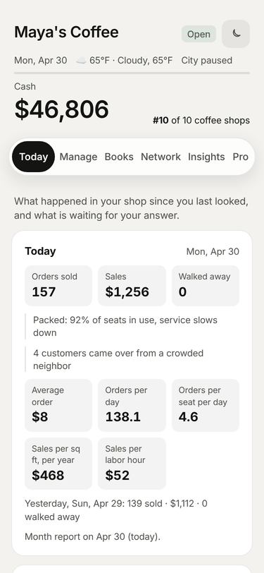
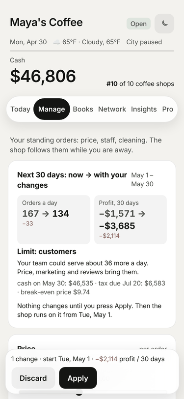
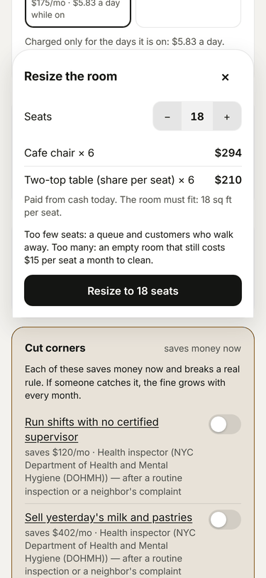
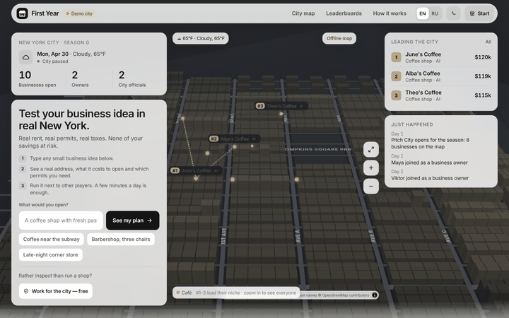
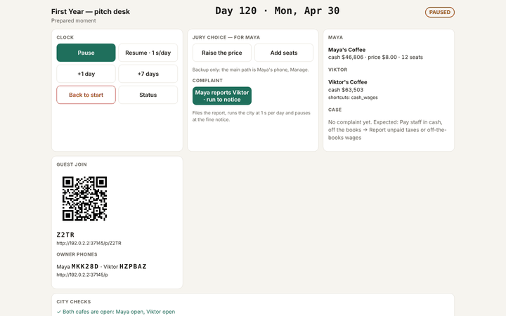
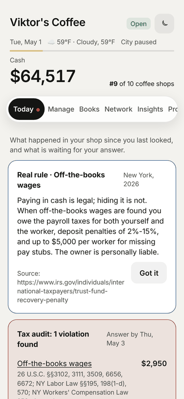

# Проверка живого показа в браузерах (B06)

Пятиминутный показ по `docs/pitch/RUNBOOK.md` сыгран в настоящих браузерах: телефон Maya (375×812), телефон Viktor (375×812), проектор (1440×900, гостевой код), пульт ведущего `/pitch`. Одной командой:

```bash
node scripts/e2e/pitch-show.mjs
```

Ветка жюри «больше мест»: `--branch seats`. Против публичного адреса: `--url https://<адрес> --key <CLOCK_KEY>` (в конце город показа возвращается в начало). Снимки и `PITCH.md` — в `docs/qa/runs/<время>-pitch/`.

## Финальная проверка — 15 ноября, 03:47 UTC, сборка B04 `363d3ef` (заморозка)

**Обе ветки: 12 из 12.**

- **Ветка «больше мест» теперь показывает последствие до нажатия** (№17 исправлен): «Next 30 days: now → with 18 seats · orders a day 193 → 212 · profit $1,666 → $3,722». На сцене это сильный момент: решение жюри видно в деньгах сразу.
- Ветка «выше цены»: «Orders a day 193 → 157 (−36) · Profit, 30 days +$1,666 → +$305 (−$1,361) · Limit: customers» — модель говорит «дороже хуже». Реплика должна это выдержать.
- **Заметки «Packed: …% of seats in use» на Today у Maya по-прежнему нет**, а RUNBOOK показывает её на 1:20–1:40. Сверить реплику с экраном (A5, B17).
- Жалоба с телефона → уведомление Viktor через 1 с, штраф $2 950 → «Pay» → «Back to start» возвращает город; пульт по-прежнему не видит жалобу, поданную с телефона.
- Мелочь: на 375 липкий ряд вкладок закрывает заголовок листа «Resize the room».

## Повтор — 15 ноября, 00:40 UTC, сборка B04 `59336e8` (после калибровки экономики B11)

**Обе ветки: 12 из 12.** Что изменилось и важно для сцены:

- **На Today у Maya больше нет заметки «Packed: …% of seats in use».** RUNBOOK на 1:20–1:40 велит показать её на сцене («На Today заметка «Packed…»»). Проверка `room_full` в сборке города показа проходит (11/11), а на экране заметки нет. **Кому:** A5 / B17 — сверить реплику с экраном перед репетицией; ведущему — решить, нужна ли заметка.
- Maya теперь в плюсе: прогноз месяца до изменения +$1 666. Ветка «выше цены» ($8.00 → $8.80): «Orders a day 193 → 157 (−36) · Profit, 30 days +$1,666 → +$305 (−$1,361) · Limit: customers» — модель по-прежнему говорит, что дороже хуже.
- Ветка «больше мест» (12 → 18): лист по-прежнему без прогноза (№17).
- Жалоба с телефона → уведомление Viktor через 1 с, штраф $2 950 → «Pay» на его телефоне → касса $67 204 → $64 254 → «Back to start».

## Результат — 14 ноября, 23:45 UTC, сборка сборщика B04 `c49c646`

**Обе ветки: 12 шагов из 12.**

| Шаг | Что видно |
|---|---|
| Город показа собран | день 120 (Mon, Apr 30), проверки 11/11; сборка заняла около 60 с от старта сервера |
| Телефон Maya, `/p/<код>` | её кофейня, Today: «Packed: 92% of seats in use, service slows down», 138 заказов в день |
| Телефон Viktor, `/p/<код>` | его кофейня |
| Проектор, гостевой код | главная города показа: карта, лидеры, лента — без владельца |
| QR для жюри | `/p/<код>/qr.svg` отдаётся, `image/svg+xml` |
| Пульт `/pitch` с ключом | Pause · Resume · 1 s/day · +1 day · +7 days · Back to start · Status · Raise the price · Add seats · Maya reports Viktor |
| Ветка «выше цены» с телефона | $8.00 → $8.80; прогноз до нажатия: «Orders a day 167 → 134 (−33) · Profit, 30 days −$1,571 → −$3,685 (−$2,114) · Limit: customers» |
| Ветка «больше мест» с телефона | 12 → 18 мест; лист «Resize the room»: стулья $294, столы $210 — **прогноза нет** (см. ниже) |
| Жалоба Maya с телефона | «Report filed: Viktor's Coffee» на её экране |
| Пульт: Resume 1 s/day | уведомление Viktor о штрафе через 1 с (1 игровой день): $2 950 |
| Телефон Viktor: «Pay $…» | касса $64 517 → $61 567 |
| Пульт: Back to start | день 120, пауза, жалобы нет; телефон Maya по-прежнему в её кофейне |

 

## Что важно для сцены (A5, B17, ведущему)

1. **Ветка «выше цены» на этой сборке ухудшает месяц**: −$2 114 за 30 дней, «Limit: customers». Это честный ответ модели; реплика на сцене должна это выдержать («the game says no — and shows why»), а не обещать рост.
2. **Ветка «больше мест» не показывает последствия до нажатия.** В листе «Resize the room» только цена мебели и правило «18 sq ft per seat». Движок умеет прогноз (`what_if` с полем `size`), экран его не спрашивает. Жюри выбирает — и ничего не видит до следующего дня. **Кому:** B08 (`client/src/screens/business/ManageTab.tsx`, лист «Resize the room»: строка «Next 30 days with 18 seats: orders a day, profit» из `what_if { size }`). В `BUGS.md` — №17.

   

3. **Пульт не видит жалобу, поданную с телефона.** Статус пульта показывает только жалобу, поданную его собственной кнопкой «Maya reports Viktor» (`complaintCaseId` в `server/src/pitch.ts`), и автопауза на уведомлении работает только для неё. По RUNBOOK основной путь — жалоба с телефона Maya, а «после уведомления — Pause» ведущий должен ловить глазами. На этой сборке уведомление приходит через 1 игровой день (≈1 с при 1 s/day), так что пауза нужна сразу после Resume. **Кому:** A5 — отслеживать любое новое дело по Viktor, а не только своё.
4. Проектор по гостевому коду открывает главную страницу города (карта, лидеры, лента). Если на сцене нужна карта во весь экран — открыть «City map».

  
